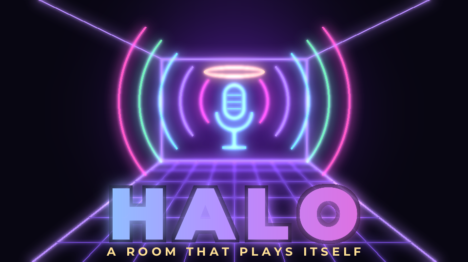

# HALO – a room that plays itself



HALO has no performer. It has a microphone and a room.

Whoever walks through plays it – without knowing. A step strikes a bell, a conversation turns into a choir, a cough
becomes a chord, a child humming moves the harmony. When everyone has left, the room keeps singing what it heard last,
slower and slower, until the next person comes in.

HALO learns the silence of the place it hangs in. It does not answer noise, it answers change. Every space sounds
different, every hour of the day sounds different – nobody hears the same piece twice.

For lobbies, galleries, stations, shop windows, stairwells, churches, waiting rooms. Microphone in, speakers out, leave it.

**Try it in the browser:** https://play.thefirmwarehub.com/?fw=halo – click *Audio input*, allow the microphone,
headphones on (or the speakers away from the mic).

HALO is a native firmware for [VIBE FM](https://thefirmwarehub.com/platform/): the VIBE FM Mk1, the plugin (VST3 / CLAP /
AU) and the browser run the same `.wasm`.

## What it listens to

| | |
|---|---|
| **Floor** | the room's own level, learnt all the time – rises slowly (ADAPT, 60 s), falls fast. Everything is measured above it, so a busy place becomes the new quiet and HALO hearing itself never feeds itself |
| **Presence** | how far above the floor the room is – the drone's level (SWELL: busier = fuller · CALM: busier = softer · STEADY) |
| **Onsets** | steps, claps, syllables |
| **Pitch** | a hummed or sung note (YIN, 60 Hz – 1 kHz): held long enough, it moves the chord to that degree of the scale |
| **Brightness** | the share above 2.5 kHz – it opens the choir's vowel |
| **Guard** | a feedback howl is a rigid sine (within 8 cents for 1.5 s – no voice does that): the mic is ducked 18 dB for 8 s |

## Four engines

- **BLOOM** – six strings tuned to the chord, set ringing by the room itself, like sympathetic strings or a piano with
  the pedal down.
- **CLOUD** – 12 s of what the microphone heard, up to 24 grains, each one retuned from the pitch it carries to the
  nearest chord note. Talk becomes song; an empty room keeps singing the last voices.
- **CHOIR** – six voices of detuned saws through formant filters; the chord follows a hummed pitch, the room's
  brightness moves the vowel.
- **CHIMES** – every sound in the room strikes an FM bell from the chord, close to the pitch it heard; a soft pad below.

Then a big space: an 8-line feedback delay network (T60 2 – 60 s) with shimmer, the room's own voices sent into it.
Key, scale (10), voicing (OPEN, FIFTHS, CLOSE, CLUSTER), FOLLOW and MOVE (the chord wanders by itself). 16 programs on the
pads that morph into each other; **WANDER** changes them on its own every few minutes – for an installation.
**HUSH** (STOP) fades everything out, **FREEZE** holds the moment.

No microphone at hand? The keys sing a test voice into the input.

## Controls

K1–K6 = LISTEN · ENGINE · TONE · SPACE · MOTION · WANDER – the same key again is the next sub-page. Encoders 1–4 = the
page's values, A = level, B = space, DATA = program. F1 FREEZE · F2 PRESETS · F3/F4 program −/+ · F5 SAVE · F6 GLOBAL.
`cheatsheet.html` (German) lists every key, `KONZEPT.md` is the design notebook (German), `TEXTE.md` the texts.

## Build

Built with the VIBE FM SDK. Put this repository at `firmware/halo/` in the SDK, then:

```
tools/build.sh halo                      # build/halo.wasm (+ halo.vibe.aot for the device)
node tools/vibe-check.mjs build/halo.wasm
tools/deploy-device.sh halo              # onto a VIBE
```

Files: `listen.c` the ears (floor, onsets, pitch, harmony, guard, test voice) · `engines.c` the four engines ·
`space.c` reverb, shimmer, master · `main.c` events, pages, programs · `ui.c` the display.

## License

GPL-3.0-or-later – see `LICENSE`. Copyright 2026 Sven Trogus (zvenson). The name HALO and the logo are not part of the
license.
